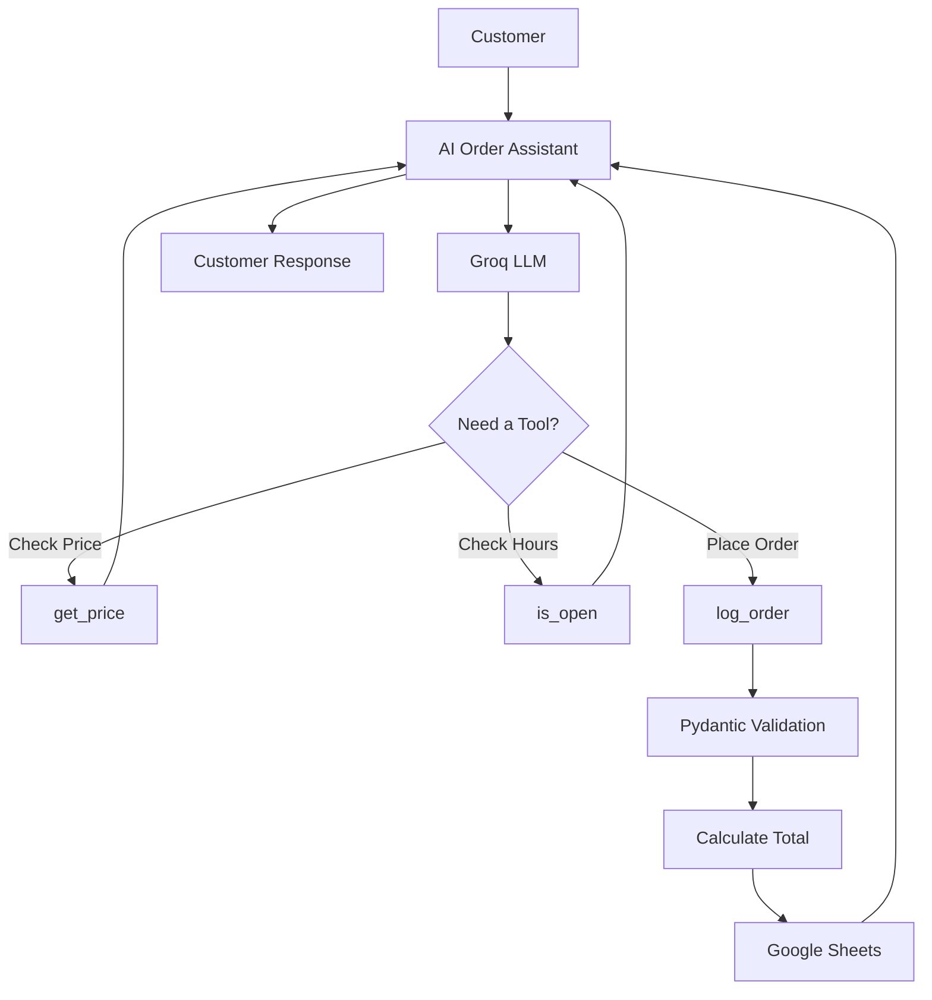

# 🍰 Sweet Crumbs Home Bakery — AI Order Assistant

An AI-powered conversational bakery ordering assistant built using **LangChain, Groq LLM, Pydantic, and Google Sheets**. The agent helps customers enquire about bakery products, check prices and business hours, and place orders through a natural language conversation.

The assistant uses tools to retrieve bakery information, validates order details, calculates order totals, and stores confirmed orders in Google Sheets — making the ordering process simple, efficient, and automated.

---

## ✨ Features

- **🛠️ Tool-Based Information Retrieval:** Uses LangChain tools (`get_price` and `is_open`) to retrieve menu prices and bakery operating hours.
- **🧁 Conversational Ordering:** Customers can interact naturally to enquire about products and place orders.
- **✅ Structured Order Validation:** Uses Pydantic to validate order information before processing.
- **📊 Google Sheets Integration:** Automatically logs confirmed orders into a Google Sheet.
- **🧮 Automatic Price Calculation:** Calculates the total order price based on the selected product and quantity.
- **💬 Conversation Memory:** Maintains conversation history across multiple interactions.
- **🌐 Multilingual Support:** Responds in English or Telugu, matching the customer's language.
- **🔄 Error Handling:** Handles invalid inputs and execution errors with retry support.
- **🤖 LLM-Powered Agent:** Uses Groq's `openai/gpt-oss-20b` model to understand requests and coordinate tools.

---

## 🧰 Tech Stack

| Technology | Purpose |
|---|---|
| Python | Core programming language |
| Google Colab | Development and execution environment |
| LangChain | Agent framework and tool orchestration |
| Groq API | LLM inference |
| `openai/gpt-oss-20b` | Language model |
| Pydantic | Order data validation |
| gspread | Google Sheets integration |
| Google Sheets | Order storage and management |

---

## 🍰 Bakery Menu

| Product | Price |
|---|---:|
| Plum Cake | ₹500 |
| Chocolate Cake | ₹650 |
| Cupcake | ₹80 |

<sub>All cakes are available in eggless versions.</sub>

---

## 🕒 Bakery Operating Hours

| Day | Timings |
|---|---|
| Monday – Saturday | 9:00 AM – 8:00 PM |
| Sunday | 10:00 AM – 6:00 PM |

- Orders require **at least 24 hours' advance notice**.
- Eggless options are available for all cakes.

---

## ⚙️ How It Works

1. **Customer Interaction:** The customer asks about products, prices, bakery timings, or wants to place an order.
2. **Tool Invocation:** The agent uses appropriate tools to retrieve information such as menu prices or opening hours.
3. **Order Collection:** The agent collects the required order details.
4. **Validation:** Pydantic validates the order details, including the customer's name, item, quantity, date, and eggless preference.
5. **Price Calculation:** The total order cost is calculated based on the product and quantity.
6. **Order Logging:** Once the order is confirmed, the details are added to Google Sheets.
7. **Response:** The agent responds to the customer with an order summary in English or Telugu.

---

## 🏗️ Architecture



---

## 🚀 Setup & Execution

### 1. Open Google Colab

Open the project notebook in Google Colab.

### 2. Configure Groq API Key

- Open **Secrets** in Google Colab.
- Add your Groq API key.
- Set the secret name as:

```text
GROQ_API_KEY
```

### 3. Install Dependencies

Run the installation cell in the notebook to install the required packages:

```bash
pip install langchain langchain-groq gspread
```

### 4. Authenticate Google Account

Authenticate your Google account in Colab to allow the notebook to access Google Sheets.

### 5. Initialize Google Sheets

The notebook creates or opens the spreadsheet:

**Sweet Crumbs Orders**

The sheet contains the following columns:

| Column |
|---|
| name |
| item |
| qty |
| date |
| eggless |
| total |

### 6. Run the Notebook

Execute all cells sequentially to:

- Initialize the tools.
- Configure the Pydantic schema.
- Connect to Google Sheets.
- Initialize the AI agent.
- Start interacting with the bakery assistant.

---

## 💬 Sample Interactions

**Customer:**
> What is the price of a chocolate cake?

**Assistant:**
> A chocolate cake costs ₹650.

**Customer:**
> Are you open on Sunday?

**Assistant:**
> Yes! We are open on Sunday from 10:00 AM to 6:00 PM.

**Customer:**
> I want to order 2 cupcakes for December 2. My name is Rahul.

**Assistant:**
> Sure! Your order details are ready for confirmation.

---

## 📊 Order Management

Confirmed orders are automatically stored in the **Sweet Crumbs Orders** Google Sheet.

| Name | Item | Qty | Date | Eggless | Total |
|---|---|---:|---|---|---:|
| Rahul | Cupcake | 2 | 2026-12-02 | No | ₹160 |

<sub>The above row is an illustrative example.</sub>

---

## 🔐 Security & Configuration

- Store API keys in Google Colab Secrets.
- Do not hardcode API keys in the notebook.
- Authenticate Google Sheets through your Google account.
- Avoid committing credentials or sensitive customer information to GitHub.

---

## 🎯 Project Objective

This project demonstrates how AI agents can integrate language models, external tools, structured data validation, conversation memory, and cloud-based data storage to automate a real-world ordering workflow.

---

## 👩‍💻 Author

**RamyaSri Chakka**

---

⭐ *Built as part of hands-on learning in AI Agents, LangChain, LLM tool calling, and workflow automation.*
